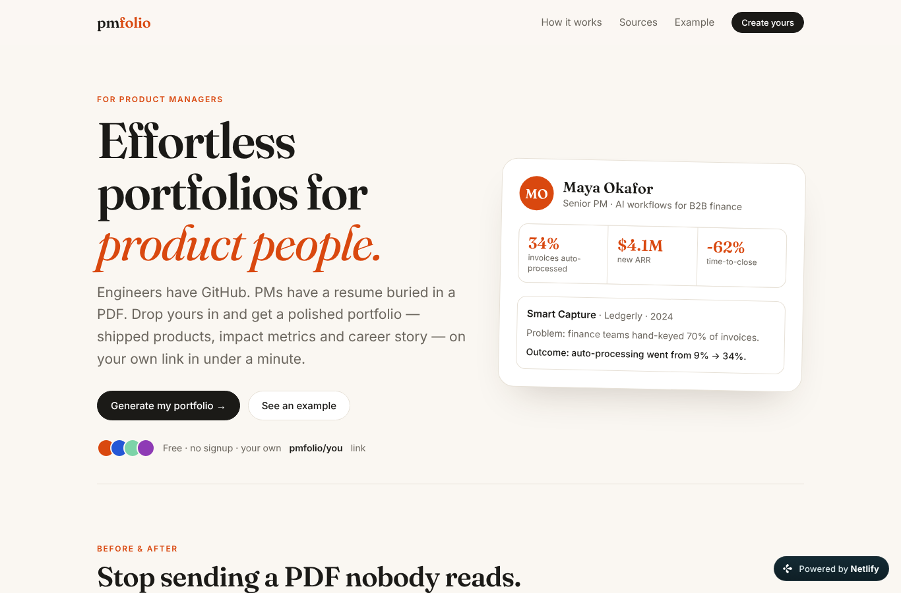

# pmfolio

**Effortless portfolios for product managers.**

Engineers have GitHub. PMs have a resume buried in a PDF. pmfolio turns your LinkedIn export or resume into a polished portfolio on your own link: shipped products, impact metrics, career timeline and writing. It takes about a minute.

Inspired by [devb.io](https://devb.io) ([source](https://github.com/sunithvs/devb.io)), which does the same for developers using GitHub.

**Live:** https://pmfolio-app.netlify.app · **Example:** https://pmfolio-app.netlify.app/demo

[](https://app.netlify.com/start/deploy?repository=https://github.com/adityanataraj/pmfolio)



## Features

- **One input, full portfolio.** Upload a LinkedIn "Save to PDF" export or a resume, or paste text. The PDF is parsed in the browser with pdf.js.
- **AI drafting built for PMs.** Claude extracts products shipped as *problem → what I did → outcome*, pulls out quantified impact metrics, and writes a headline and bio. It's told to use only facts from the source and never invent numbers.
- **Edit with a live preview.** Every field is editable. Four themes, desktop and mobile preview, reorder and add or remove items. Unsaved drafts are kept in the browser.
- **Your own URL.** Publish to `/your-name`. There are no accounts: each portfolio gets a private edit link (only a SHA-256 hash of the key is stored).
- **Writing that updates itself.** Point it at a Substack, Medium or any RSS blog and your latest posts appear on your page, refreshed every 6 hours.
- **Resume download.** A print stylesheet turns any portfolio into a clean PDF resume.
- **SEO-ready.** Portfolios are server-rendered with Open Graph tags.
- **No manual form needed.** You can also skip the AI and start from a blank template.

| Editor | Portfolio |
|---|---|
|  |  |

## How it works

```
public/                     static frontend, no build step
  index.html                landing page
  create/index.html         builder (import → edit → publish)
  create.js                 builder logic
  render.js                 shared renderer: profile JSON → HTML (used by browser preview AND server)
  styles.css
netlify/
  functions/
    generate.mts            POST /api/generate     resume text → structured profile (Claude, tool-use JSON)
    publish.mts             POST /api/publish      claim username / save edits / delete (edit-key protected)
    profile-api.mts         GET  /api/profile/:u, /api/available/:u
    page.mts                GET  /:username        server-rendered portfolio + RSS feed (cached in Blobs)
  lib/
    shared.mts              storage, validation, sanitising
    demo.mts                fictional profile served at /demo
```

- **Hosting:** Netlify (static site + Functions)
- **Storage:** Netlify Blobs: a `profiles` store (one JSON record per username) and a `feeds` store (RSS cache)
- **AI:** Anthropic Claude via the official SDK. Netlify AI Gateway supplies credentials automatically on credit-based plans, or you can bring your own key.

## Deploy your own

1. Click **Deploy to Netlify** above, or fork the repo and import it in Netlify.
2. Set up AI, choosing one of:
   - **Netlify AI Gateway** (no key needed). Your Netlify team must be on a [credit-based plan](https://docs.netlify.com/build/ai-gateway/overview/), including the new Free plan. The gateway activates after the first production deploy, so redeploy once.
   - **Your own Anthropic key.** Add `ANTHROPIC_API_KEY` under *Project configuration → Environment variables* with the scope set to Functions, then redeploy.
3. Optional: add a custom domain under *Domain management*. Portfolio URLs follow it automatically (`yourdomain.com/username`).

### Environment variables

| Variable | Required | Purpose |
|---|---|---|
| `ANTHROPIC_API_KEY` | Only without AI Gateway | Your Anthropic API key |
| `PMFOLIO_MODELS` | No | Comma-separated model order, e.g. `claude-sonnet-5-5,claude-haiku-5-5` |

## Local development

```bash
npm install
npx netlify-cli link        # link to your Netlify project
npx netlify-cli dev         # http://localhost:8888
```

Blobs use a local sandbox in dev. AI generation needs either the gateway (after a production deploy) or `ANTHROPIC_API_KEY` in your environment.

## Roadmap

Ideas for contributors:

- [ ] Product Hunt, App Store and Notion case-study imports
- [ ] "PM Wrapped" shareable image card
- [ ] Per-portfolio view analytics
- [ ] "Contact me" form
- [ ] Case-study pages (long-form, one per product)
- [ ] More themes, and custom accent colours
- [ ] Recovering an edit key by email

## Contributing

PRs welcome. See [CONTRIBUTING.md](CONTRIBUTING.md).

## License

[MIT](LICENSE)
